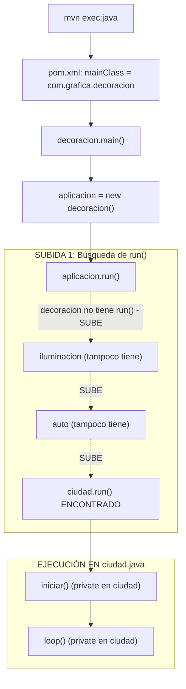
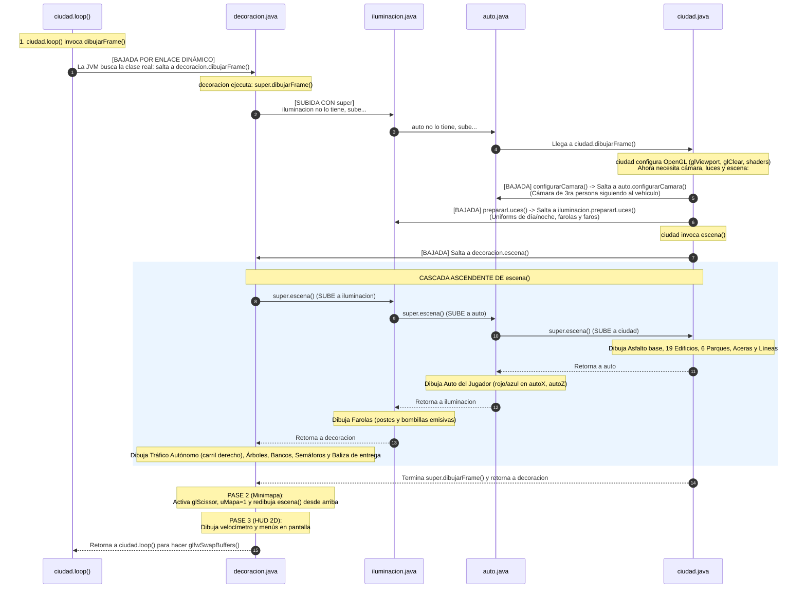
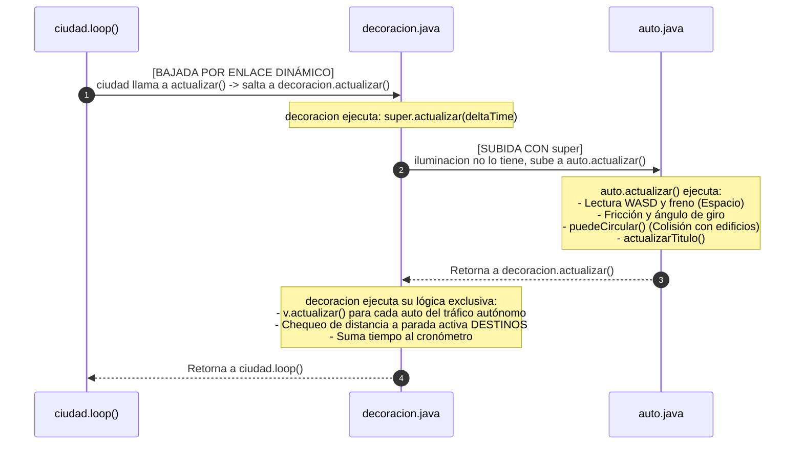
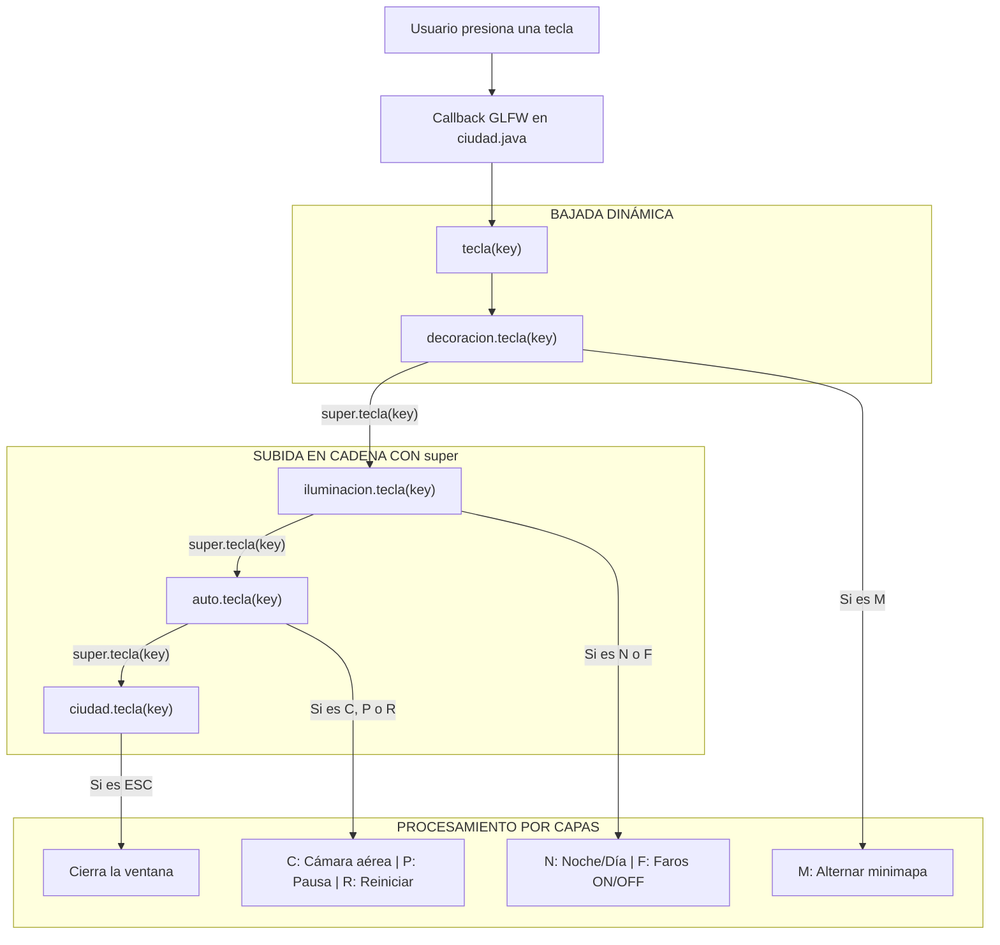

# Flujo de Ejecución Detallado: El Viaje entre Clases Hijas y Padres

Este documento explica con precisión el **"viaje de ida y vuelta"** que realizan los métodos en el proyecto mediante los mecanismos de **Herencia, Enlace Dinámico (Dynamic Dispatch) y llamadas a `super`** en Java.

---

## 1. El Objeto en Memoria y la Jerarquía

Cuando el programa arranca, solo existe **una única instancia** en la memoria RAM:

```
[ Objeto en Memoria: new decoracion() ]
  └── Capa 4: decoracion.java   (Entregas, Tráfico, Minimapa, HUD)
        └── Capa 3: iluminacion.java  (Día/Noche, Farolas, Faros)
              └── Capa 2: auto.java         (Física WASD, Cámara 3ra persona)
                    └── Capa 1: ciudad.java       (Ventana GLFW, Shaders GPU, Bucle loop)
```

> **Principio Clave de Java (Enlace Dinámico):**  
> Aunque un método esté escrito dentro del archivo `ciudad.java`, cuando llama a un método no estático ni privado (como `dibujarFrame()` o `actualizar()`), la Máquina Virtual de Java (JVM) busca la versión de la clase **más específica** en el objeto en memoria (es decir, baja hasta `decoracion`).

---

## 2. El Viaje Inicial: de Maven al Bucle de Juego



### Paso a paso del arranque:
1. `mvn exec:java` ejecuta `decoracion.main(args)`.
2. `decoracion.main` crea la instancia y llama a `aplicacion.run()`.
3. Como `decoracion`, `iluminacion` y `auto` **no definen `run()`**, Java sube automáticamente por la jerarquía hasta encontrar **`ciudad.run()`**.
4. `ciudad.run()` toma el control y ejecuta sus métodos internos:
   * **`iniciar()`**: Crea la ventana GLFW, inicializa OpenGL 3.3, compila shaders y crea el cubo en la GPU.
   * **`loop()`**: Comienza el bucle continuo a ~60 cuadros por segundo.

---

## 3. El Viaje de `dibujarFrame()`: Bajada y Subida en Cada Fotograma

Dentro de `ciudad.loop()` (línea 105), el código fuente dice textualmente:

```java
// Archivo: ciudad.java (línea 105)
dibujarFrame();
```

Aquí comienza el viaje más importante del proyecto:



### Explicación detallada de este ciclo:

1. **La Bajada (`ciudad` $\rightarrow$ `decoracion`)**:  
   `ciudad.loop()` llama a `dibujarFrame()`. Aunque `ciudad` tiene un método `dibujarFrame()`, la variable oculta `this` es de tipo `decoracion`. La JVM ignora el método de `ciudad` y **desciende directamente hasta `decoracion.dibujarFrame()`**.

2. **La Subida con `super` (`decoracion` $\rightarrow$ `ciudad`)**:  
   En la línea 308 de `decoracion.java`, la primera instrucción es:
   ```java
   super.dibujarFrame();
   ```
   Java sube buscando un padre que tenga `dibujarFrame()`. Ni `iluminacion` ni `auto` lo sobrescriben, así que la llamada **sube hasta `ciudad.dibujarFrame()`**.

3. **La Distribución dentro de `ciudad.dibujarFrame()`**:  
   Una vez arriba en `ciudad.java`, este método prepara el lienzo OpenGL (`glViewport`, `glClear`, activa shaders) y llama a tres métodos clave:
   * **`configurarCamara()`**: En lugar de usar la cámara orbital de `ciudad`, la JVM desciende a **`auto.configurarCamara()`** para ubicar la vista en 3ra persona detrás del carro.
   * **`prepararLuces()`**: En lugar del método vacío de `ciudad`, la JVM desciende a **`iluminacion.prepararLuces()`** para enviar las luces nocturnas y faros.
   * **`escena()`**: En lugar de dibujar solo la ciudad, la JVM desciende a **`decoracion.escena()`**.

4. **La Gran Cascada de `escena()`**:  
   `decoracion.escena()` no dibuja todo desde cero; primero llama a `super.escena()`, provocando una cadena hacia arriba:
   $$\text{decoracion} \xrightarrow{super} \text{iluminacion} \xrightarrow{super} \text{auto} \xrightarrow{super} \text{ciudad}$$
   * Al llegar arriba, **`ciudad.escena()`** dibuja la plataforma de asfalto (110x110), aceras, los 19 edificios, parques y líneas amarillas.
   * Al regresar a **`auto.escena()`**, añade el modelo 3D del auto del jugador.
   * Al regresar a **`iluminacion.escena()`**, añade los postes y bombillas de las farolas.
   * Al regresar a **`decoracion.escena()`**, añade el tráfico en el carril derecho, árboles, bancos, semáforos, ventanas y la baliza dorada de la entrega.

5. **El Retorno y Pases Exclusivos de `decoracion`**:  
   Cuando `super.dibujarFrame()` termina por completo, el control vuelve a **`decoracion.dibujarFrame()`**, donde se procesan los elementos que solo `decoracion` conoce:
   * **Minimapa Aéreo**: Recorta con `glScissor` la esquina superior derecha, activa la proyección ortográfica cenital (`uMapa = 1`) y vuelve a llamar a `escena()` para dibujarla en miniatura.
   * **HUD 2D**: Dibuja el velocímetro gráfico y el menú de pausa flotante.
6. **Vuelta a `ciudad.loop()`**:  
   La función termina y regresa a la línea 107 de `ciudad.java`, donde `glfwSwapBuffers(ventana)` presenta la imagen generada en la pantalla.

---

## 4. El Viaje de `actualizar(deltaTime)` en Cada Fotograma

En la línea 100 de `ciudad.loop()`, se ejecuta:

```java
// Archivo: ciudad.java (línea 100)
actualizar(deltaTime);
```

Este método sigue un recorrido idéntico de bajada y subida:



### Puntos clave de `actualizar()`:
1. `ciudad.loop()` llama a `actualizar(deltaTime)` $\rightarrow$ La JVM **baja a `decoracion.actualizar()`**.
2. `decoracion.actualizar()` ejecuta `super.actualizar(deltaTime)` $\rightarrow$ **Sube a `auto.actualizar()`**.
3. `auto.actualizar()` no llama a `super` porque reemplaza la cámara de `ciudad` por el motor de física del vehículo (W/A/S/D, colisiones y velocímetro).
4. Al terminar `auto`, el control regresa a `decoracion`, que mueve los vehículos de tráfico autónomo y comprueba si el auto frenó en la marca de entrega.
5. El método finaliza y el control vuelve a `ciudad.loop()`.

---

## 5. El Viaje de los Eventos de Teclado: `tecla(key)`

El registro del callback de teclado está en `ciudad.iniciar()` (línea 78):

```java
// Archivo: ciudad.java
glfwSetKeyCallback(ventana, (..., key, ...) -> {
    if (action == GLFW_PRESS) {
        tecla(key); // <- Invocación polimórfica
    }
});
```

Cuando presionas cualquier tecla:



Cada nivel procesa exclusivamente las teclas que le corresponden y delega el resto a sus ancestros mediante `super.tecla(key)`.

---

## 6. Mapa Completo del Viaje entre Clases

| Método invocado | Invocado desde | ¿Dónde aterriza primero? (Bajada) | ¿A dónde sube con `super`? (Subida) | Responsabilidad repartida |
| :--- | :--- | :--- | :--- | :--- |
| **`run()`** | `decoracion.main` | `ciudad.run()` *(sube directo)* | N/A (Es la cúspide) | `ciudad` envuelve el ciclo de vida en `try/finally`. |
| **`iniciar()`** | `ciudad.run` | `ciudad.iniciar()` | N/A (Es `private`) | `ciudad` crea la ventana GLFW y compila shaders. |
| **`loop()`** | `ciudad.run` | `ciudad.loop()` | N/A (Es `private`) | `ciudad` controla el ciclo `while (!glfwWindowShouldClose)`. |
| **`actualizar()`** | `ciudad.loop` | **`decoracion.actualizar()`** | Sube a **`auto.actualizar()`** | `auto` calcula física/colisiones; `decoracion` mueve el tráfico y entregas. |
| **`dibujarFrame()`**| `ciudad.loop`| **`decoracion.dibujarFrame()`** | Sube a **`ciudad.dibujarFrame()`** | `ciudad` prepara OpenGL; `decoracion` añade minimapa con `glScissor` y HUD 2D. |
| **`configurarCamara()`**| `ciudad.dibujarFrame`| **`auto.configurarCamara()`** | Sube a `ciudad` solo si `camaraAerea == true` | Si no es aérea, `auto` ubica la cámara detrás del vehículo en 3ra persona. |
| **`prepararLuces()`**| `ciudad.dibujarFrame`| **`iluminacion.prepararLuces()`**| N/A | `iluminacion` carga farolas y faros al shader. |
| **`escena()`** | `ciudad.dibujarFrame`| **`decoracion.escena()`** | Sube: `decoracion` $\rightarrow$ `iluminacion` $\rightarrow$ `auto` $\rightarrow$ `ciudad` | `ciudad`: mundo base; `auto`: carro; `iluminacion`: farolas; `decoracion`: tráfico y balizas. |
| **`tecla()`** | `ciudad.iniciar` (callback) | **`decoracion.tecla()`** | Sube: `decoracion` $\rightarrow$ `iluminacion` $\rightarrow$ `auto` $\rightarrow$ `ciudad` | Cada clase procesa sus propias teclas (`ESC`, `C/P/R`, `N/F`, `M`). |
| **`reiniciar()`** | `auto.tecla` (al pulsar 'R') | **`decoracion.reiniciar()`** | Sube a **`auto.reiniciar()`** | `auto` devuelve el carro al origen; `decoracion` resetea cronómetro, entregas y tráfico. |
